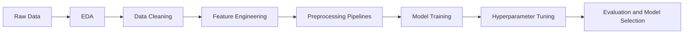

# 🧠 MindScore-ML: Predicting Mental Health Scores with Machine Learning


> An end-to-end machine learning project that predicts a person's **mental health score** from lifestyle, sleep, stress, and digital usage habits, built with clean, reproducible scikit-learn pipelines.

---

## 📌 Overview

Mental wellbeing is shaped by everyday habits such as how much we sleep, how stressed we feel, how often we use our phones, and how active we are. This project explores those relationships and builds a **regression model** that estimates a numeric Mental Health Score from these factors.

The goal was not only to train a model, but to follow a complete, professional data science workflow: exploring the data, cleaning it carefully, engineering features, building pipelines, comparing models, and tuning the best one.

## ✨ Highlights

- 🔍 **In-depth EDA** with distributions, correlation heatmap, box plots, and scatter plots
- 🧹 **Careful data cleaning**: duplicate removal, invalid value handling, outlier inspection with the IQR method
- 🛠️ **Feature engineering**: grouped rare countries into an `Other` category to reduce noise
- ⚙️ **Production-style preprocessing** with `ColumnTransformer` and `Pipeline` (no data leakage)
- 🤖 **Model comparison**: Linear Regression baseline vs. Random Forest (default and tuned)
- 🎯 **Hyperparameter tuning** with `RandomizedSearchCV` (5-fold cross-validation)
- 📊 **Multiple metrics**: R², MAE, and RMSE on both training and test sets

## 🗂️ Dataset

The dataset (`mental_health_score.csv`) contains one row per person with the following features:

| Feature | Type | Description |
|---|---|---|
| `Age` | Numeric | Age of the person |
| `Gender` | Categorical | Gender |
| `Academic_Level` | Categorical | Education level |
| `Country` | Categorical | Country (top 10 kept, the rest grouped as `Other`) |
| `Avg_Daily_Usage_Hours` | Numeric | Average daily screen/platform usage |
| `Most_Used_Platform` | Categorical | Most used platform |
| `Purpose_Of_Use` | Categorical | Main purpose of usage |
| `Daily_Unlocks` | Numeric | Number of daily phone unlocks |
| `Study_Hours` | Numeric | Daily study hours (right-skewed) |
| `Physical_Activity_Hours` | Numeric | Daily physical activity |
| `Sleep_Hours_Per_Night` | Numeric | Average sleep per night |
| `Stress_Level` | Ordinal | Low → Medium → High → Very High |
| **`Mental_Health_Score`** | **Target** | **The score the model predicts** |

> 📎 **Source:** _add the dataset link here (Kaggle / UCI / other)_

## 🔄 Workflow



### 1. Exploratory Data Analysis
Examined the target distribution, correlations between numeric features, and how stress level, sleep, screen time, and study hours relate to the mental health score.

### 2. Data Cleaning
- Removed duplicate rows
- Clipped negative `Physical_Activity_Hours` values to 0
- Checked skewness and outliers (IQR method)

### 3. Preprocessing Pipelines
| Feature group | Transformation |
|---|---|
| Skewed numeric (`Study_Hours`) | `log1p` → `StandardScaler` |
| Other numeric features | `StandardScaler` |
| Ordinal (`Stress_Level`) | `OrdinalEncoder` (Low < Medium < High < Very High) |
| Categorical features | `OneHotEncoder(handle_unknown='ignore')` |

All steps are combined in a single `ColumnTransformer` and attached to each model through `make_pipeline`, so the exact same transformations are applied at training and prediction time.

### 4. Modeling
- **Train/test split:** 70% / 30% (`random_state=42`)
- **Models:** Linear Regression (baseline), Random Forest Regressor, Random Forest with `RandomizedSearchCV`

## 📈 Results

| Model | Train R² | Test R² | MAE | RMSE |
|---|---|---|---|---|
| Linear Regression | _TBD_ | _TBD_ | _TBD_ | _TBD_ |
| Random Forest (default) | _TBD_ | _TBD_ | _TBD_ | _TBD_ |
| Random Forest (tuned) | _TBD_ | _TBD_ | _TBD_ | _TBD_ |

**🏆 Best model:** _name of the best model and its test R² / RMSE_

## 💡 Key Insights

- _Which features had the strongest relationship with the mental health score?_
- _How did sleep hours and stress level affect the score?_
- _How did the tuned model compare with the baseline?_

## 🧰 Tech Stack

- **Language:** Python
- **Data:** pandas, NumPy
- **Visualization:** Matplotlib, Seaborn
- **Machine Learning:** scikit-learn (Pipelines, ColumnTransformer, RandomForestRegressor, RandomizedSearchCV)
- **Environment:** Jupyter Notebook / Google Colab

## 📁 Project Structure

```
mindscore-ml/
├── data/
│   └── mental_health_score.csv
├── notebooks/
│   └── mental_health_score_model.ipynb
├── requirements.txt
├── LICENSE
└── README.md
```

## 🚀 How to Run

```bash
# 1. Clone the repository
git clone https://github.com/<your-username>/mindscore-ml.git
cd mindscore-ml

# 2. Install dependencies
pip install -r requirements.txt

# 3. Launch the notebook
jupyter notebook notebooks/mental_health_score_model.ipynb
```

**`requirements.txt`**
```
numpy
pandas
matplotlib
seaborn
scikit-learn
jupyter
```

## 🔮 Future Improvements

- Try gradient boosting models (XGBoost, LightGBM) and compare against Random Forest
- Add feature importance and SHAP explanations
- Wrap the model in a simple Streamlit app for live predictions
- Save the trained pipeline with `joblib` for easy deployment


## 👤 Author

**[Md Shahadat Ismail Shanto]**: Student at AIUB | Aspiring AI Engineer

- 💼 LinkedIn: [www.linkedin.com/in/md-shahadat-ismail-shanto]
- 🐙 GitHub: [your-github-url]
- 📧 Email: [mhislamsahel@gmail.com]

---

⭐ If you found this project useful, please consider giving it a star!
